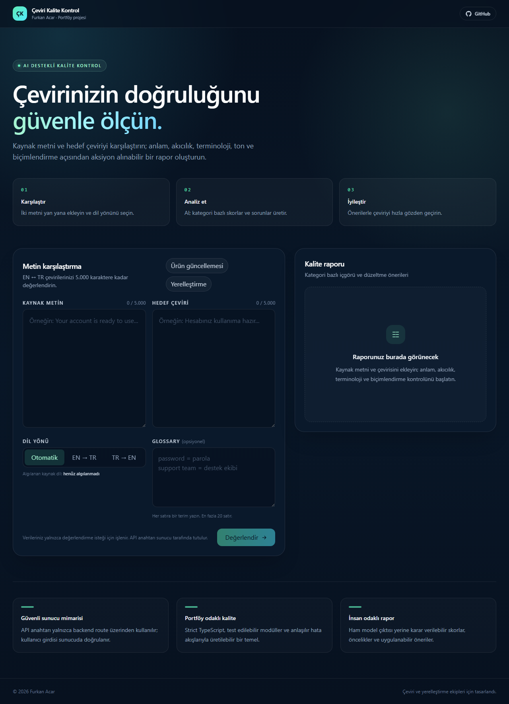

# Çeviri Kalite Kontrol

[GitHub deposu](https://github.com/acar32furkan-glitch/ceviri-kalite-kontrol) · [CI](https://github.com/acar32furkan-glitch/ceviri-kalite-kontrol/actions) · **[canlı demo](https://ceviri-kalite-kontrol.vercel.app)** · AI destekli çeviri ve yerelleştirme kalite kontrol aracı. Kaynak metin ile hedef çeviriyi karşılaştırır; anlam doğruluğu, akıcılık, terminoloji, ton ve biçimlendirme korunumu için kategori bazlı skorlar ve uygulanabilir düzeltme önerileri üretir.

[](https://github.com/acar32furkan-glitch/ceviri-kalite-kontrol/actions/workflows/ci.yml)


> **Ölçüm durumu (dürüstçe):** Bu araç şu anda **ölçülmemiş**. İnsan etiketli bir altın veri seti ve
> tekrarlanabilir bir eval harness'ı kuruluyor; rakamlar hazır olduğunda bu README'ye "Ölçülmüş kalite"
> bölümü olarak eklenecek. Uydurma metrik yayımlanmaz — kapsam ve kararlar:
> [docs/DECISIONS.md](docs/DECISIONS.md).



## Özellikler

- EN → TR ve TR → EN değerlendirme akışı
- Otomatik kaynak dil algılama fallback'u
- DeepSeek OpenAI uyumlu Chat Completions API ile sunucu taraflı kalite analizi
- Glossary/terim listesi desteği
- 0–100 genel puan ve beş kategori skoru
- Düşük, orta ve yüksek öncelikli sorun kartları
- Placeholder, sayı ve biçimlendirme korunumu kontrolü
- Boş/kısa metin, aynı metin, uzun metin ve hatalı glossary kontrolleri
- Sunucu tarafında doğrulama ve IP bazlı rate limiting
- API anahtarı yalnızca backend'de; client tarafına aktarılmaz
- Responsive, karanlık ve portföy odaklı arayüz

## Teknolojiler

- Next.js 16 App Router
- React 19
- TypeScript strict mode
- Tailwind CSS 4
- DeepSeek Chat Completions API
- Vitest
- ESLint 9

## Yerel kurulum

Gereksinimler: Node.js 20+ ve npm.

```bash
npm install
cp .env.example .env.local
```

`.env.local` dosyasına şu değişkenleri ekleyin:

```bash
DEEPSEEK_API_KEY=your_api_key
DEEPSEEK_MODEL=deepseek-v4-flash
DEEPSEEK_BASE_URL=https://api.deepseek.com
```

Uygulamayı başlatın:

```bash
npm run dev
```

Ardından `http://localhost:3000` adresini açın.

## Kontroller

```bash
npm run typecheck
npm test
npm run lint
npm run build
```

## API

`POST /api/evaluate`

```json
{
  "sourceText": "Your password has been reset.",
  "targetText": "Parolanız sıfırlandı.",
  "direction": "en-tr",
  "glossary": [{ "source": "password", "target": "parola" }]
}
```

Başarılı yanıt:

```json
{
  "report": {
    "overallScore": 92,
    "categoryScores": {
      "accuracy": 94,
      "fluency": 91,
      "terminology": 93,
      "tone": 90,
      "formatting": 92
    },
    "issues": []
  }
}
```

Backend, gelen metinleri talimat olarak değil yalnızca değerlendirilecek veri olarak işler. Hatalı JSON, aşırı uzun metin ve yapılandırma sorunları kullanıcıya güvenli ve anlaşılır mesajlarla döner.

## Teknik kararlar

- **Next.js App Router:** sayfa ve API route'larını tek bir tutarlı full-stack repo'da toplar.
- **Sunucu taraflı AI çağrısı:** API anahtarını client bundle'a taşımaz ve model yanıtını merkezî doğrulamadan geçirir.
- **Strict TypeScript ve ayrıştırılmış modüller:** prompt üretimi, validasyon, rate limiting ve API akışı bağımsız test edilebilir.
- **Tailwind CSS:** responsive arayüzü hızlı ve tutarlı biçimde oluşturur; özel renk ve arka plan katmanları proje kimliğini korur.
- **MVP sınırı:** Metin başına 5.000 karakter sınırı, faz 3'teki segment tabanlı uzun doküman desteğine geçişi netleştirir.

## Faz planı

- **Faz 0 (tamamlandı):** bozuk `package-lock.json` onarıldı → CI yeşil; `docs/DECISIONS.md`
  (ADR-001…007); iç prompt `docs/MASTER_PROMPT.md` altına taşındı; Vercel deploy'u çalışır hâle geldi.
- **Faz 1 (sürüyor):** etiketleme kılavuzu (`docs/ANNOTATION_GUIDE.md`), kör etiketleme arayüzü
  (`/eval/label`), JSONL şema doğrulaması (`npm run eval:validate`).
- **Faz 2:** insan etiketlemesi (≈40 `dev` + 60 `test`), `dev`/`test` ayrımı ve test setinin
  dondurulması (içerik hash'i).
- **Faz 3:** enjekte hata üreticisi (seed'li), prompt injection seti, `eval:replay` (CI'da, LLM'siz) ve
  `eval:live` (bütçe/backoff/resume) çalıştırıcıları, metrikler + bootstrap güven aralıkları.
- **Faz 4:** baseline ölçüm; yalnızca `dev` seti üzerinde iyileştirme — biçimlendirme korumasını LLM'den
  **deterministik kontrole** taşıma, prompt sürümleme.
- **Faz 5:** donmuş `test` setiyle nihai ölçüm, `docs/EVAL.md` üretimi, CI regresyon eşiği,
  bu README'ye "Ölçülmüş kalite" bölümü.
- **Faz 6:** `v0.2.0` sürüm etiketi ve son temizlik.

## Deploy

Üretim: **[ceviri-kalite-kontrol.vercel.app](https://ceviri-kalite-kontrol.vercel.app)** — Vercel projesi
depoya bağlı, her `main` push'unda otomatik dağıtılır.

Değerlendirme ucu için Vercel proje ayarlarına `DEEPSEEK_API_KEY` (ve isteğe bağlı `DEEPSEEK_MODEL`,
`DEEPSEEK_BASE_URL`) eklenmelidir; anahtar yoksa API açık ve anlaşılır bir yapılandırma hatası döner,
arayüz çalışmaya devam eder. Production'da rate limiting'i paylaşımlı depolama veya platform düzeyinde
güçlendirin.

## Lisans

MIT. Detaylar için [LICENSE](LICENSE) dosyasına bakın.
